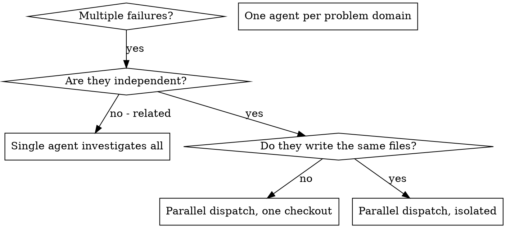

# Dispatching Parallel Agents

## Overview

You delegate tasks to agents that run on their own context, not yours. That keeps them focused and keeps your own context free for coordination.

What context they start from is a choice you make, not a rule. A **fresh** subagent gets only what you construct for it. A **forked** subagent inherits this conversation. Both leave your working context intact; they differ in what the agent knows when it starts. See "Fresh or forked" below.

When you have multiple unrelated failures (different test files, different subsystems, different bugs), investigating them sequentially wastes time. Each investigation is independent and can happen in parallel.

**Core principle:** Dispatch one agent per independent problem domain. Let them work concurrently.

## When to Use



**Use when:**
- 3+ test files failing with different root causes
- Multiple subsystems broken independently
- Each problem can be understood without context from others
- No shared state between investigations

**Don't use when:**
- Failures are related (fix one might fix others)
- Need to understand full system state

**Overlapping files is not on that list.** Two agents that would write the same
file need isolation, not serialization — see "Overlap means isolate" below.

## Overlap means isolate

Two agents that would write the same file are not a reason to give up on
parallelism. They are a reason to give each one its own working tree:

```text
Agent(isolation: "worktree")   # each agent gets its own checkout
```

Then merge the branches when they return. This is the normal answer for
overlapping source files.

**One exception, and it matters.** A worktree does not dissolve a conflict in a
shared manifest, lockfile, or generated file. Two agents both adding
dependencies to one `package.json`, both writing one migrations directory, or
both regenerating one schema will conflict at merge time instead of at write
time, and you will have a lockfile to reconcile by hand. For those files, give
one agent ownership: have it make the edits up front while the others treat the
file as read-only, or serialize just the tasks that touch it.

Genuinely coupled reasoning is still a reason for one agent. "Fixing A might fix
B" is coupling. "A and B both import from `types.ts`" is not — that is overlap,
and overlap has a mechanism.

## Fresh or forked

**Fresh** — the agent gets only the brief you write. Right for self-contained
work: a test file to fix, a subsystem to trace, a module to document. Most
dispatches are fresh.

**Forked** — `Agent(subagent_type: "fork")` gives the agent this conversation:
its history, its reasoning, its dead ends. Right when reconstructing the
situation would cost more than the work itself. You have spent an hour narrowing
a bug and want a second architecture explored from where you already stand; a
fresh agent would spend that hour again.

**The trap.** A fork inherits your conclusions, so it is the wrong tool for
challenging them. Asking a fork to stress-test your diagnosis hands it the
diagnosis first, which is the bias you were trying to escape. Adversarial checks
on your own reasoning get a fresh agent, briefed from the evidence rather than
from what you concluded.

## The Pattern

### 1. Identify Independent Domains

Group failures by what's broken:
- File A tests: Tool approval flow
- File B tests: Batch completion behavior
- File C tests: Abort functionality

Each domain is independent - fixing tool approval doesn't affect abort tests.

### 2. Create Focused Agent Tasks

Each agent gets:
- **Specific scope:** One test file or subsystem
- **Clear goal:** Make these tests pass
- **Done means:** checkable conditions — these tests pass, the rest of the file still passes, nothing outside scope changed
- **Constraints:** Don't change other code
- **When to stop and report instead:** the fix needs code outside scope, or anything destructive
- **Expected output:** "Needs from you" first (decisions, blockers), then what you found and fixed, with the test command and its output as evidence, and anything you could not confirm with where you looked

### 3. Dispatch in Parallel

Issue all three subagent dispatches in the same response — they run in parallel:

```text
Subagent (general-purpose): "Fix agent-tool-abort.test.ts failures"
Subagent (general-purpose): "Fix batch-completion-behavior.test.ts failures"
Subagent (general-purpose): "Fix tool-approval-race-conditions.test.ts failures"
# All three run concurrently.
```

Multiple dispatch calls in one response = parallel execution. One per response = sequential.

### 4. Review and Integrate

When agents return:
- Read each summary, and check its evidence (the command output it claims) before accepting it
- Verify fixes don't conflict
- Run full test suite
- Integrate all changes

To correct an agent that is still running or just returned, send it a
follow-up message rather than dispatching a new one — it keeps what it has
already learned.

## Agent Prompt Structure

Good agent prompts are:
1. **Focused** - One clear problem domain
2. **Self-contained** - All context needed to understand the problem
3. **Specific about output** - What should the agent return?

```markdown
Fix the 3 failing tests in src/agents/agent-tool-abort.test.ts:

1. "should abort tool with partial output capture" - expects 'interrupted at' in message
2. "should handle mixed completed and aborted tools" - fast tool aborted instead of completed
3. "should properly track pendingToolCount" - expects 3 results but gets 0

These are timing/race condition issues. Your task:

1. Read the test file and understand what each test verifies
2. Identify root cause - timing issues or actual bugs?
3. Fix by:
   - Replacing arbitrary timeouts with event-based waiting
   - Fixing bugs in abort implementation if found
   - Adjusting test expectations if testing changed behavior

Do NOT just increase timeouts - find the real issue.

Done when all 3 tests pass and the rest of the file still passes. If the
fix needs changes outside src/agents/, stop and report instead.

Return: anything you need from me first; then root cause per test, what you
changed, and the test command with its output. Mark anything you could not
confirm.
```

## Common Mistakes

**❌ Too broad:** "Fix all the tests" - agent gets lost
**✅ Specific:** "Fix agent-tool-abort.test.ts" - focused scope

**❌ No context:** "Fix the race condition" - agent doesn't know where
**✅ Context:** Paste the error messages and test names

**❌ No constraints:** Agent might refactor everything
**✅ Constraints:** "Do NOT change production code" or "Fix tests only"

**❌ Vague output:** "Fix it" - you don't know what changed
**✅ Specific:** "Return summary of root cause and changes"

## When NOT to Use

**Related failures:** Fixing one might fix others - investigate together first
**Need full context:** Understanding requires seeing entire system
**Exploratory debugging:** You don't know what's broken yet

Shared state used to be on this list. It is not a reason to serialize; it is a
reason to isolate. See below.

## Real Example from Session

**Scenario:** 6 test failures across 3 files after major refactoring

**Failures:**
- agent-tool-abort.test.ts: 3 failures (timing issues)
- batch-completion-behavior.test.ts: 2 failures (tools not executing)
- tool-approval-race-conditions.test.ts: 1 failure (execution count = 0)

**Decision:** Independent domains - abort logic separate from batch completion separate from race conditions

**Dispatch:**
```
Agent 1 → Fix agent-tool-abort.test.ts
Agent 2 → Fix batch-completion-behavior.test.ts
Agent 3 → Fix tool-approval-race-conditions.test.ts
```

**Results:**
- Agent 1: Replaced timeouts with event-based waiting
- Agent 2: Fixed event structure bug (threadId in wrong place)
- Agent 3: Added wait for async tool execution to complete

**Integration:** All fixes independent, no conflicts, full suite green

## Verification

After agents return:
1. **Review each summary** - Understand what changed, and check the evidence it cites; a claim without output is unverified
2. **Check for conflicts** - Did agents edit same code?
3. **Run full suite** - Verify all fixes work together
4. **Spot check** - Agents can make systematic errors

## Beyond this tier

This skill covers subagents. When the work does not fit them — a mechanical
change across dozens of separately reviewable units, workers that must agree on
a contract as they go, a fan-out too large to drive from one context, or a job
that should leave your session entirely — use **superpowers:orchestrating-agents**
to pick the mechanism first.
