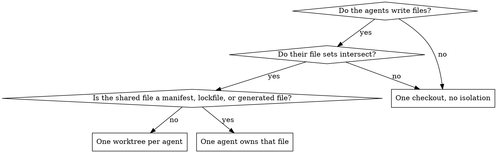

# Orchestrating Agents

## Overview

**Who does the work and where they do it are two separate decisions.** Older
guidance folds them together, finds that two agents would touch the same file,
and concludes "do not parallelize." That is the wrong conclusion from the right
observation. Collision is an isolation problem. Decide the mechanism first, then
decide the isolation.

**Announce at start:** "I'm using the orchestrating-agents skill to choose how to
run this."

Every rule below keys to a predicate you can check *before* dispatching. None
key to how hard the task feels.

## Routing

Take the first row that matches.

| Predicate | Mechanism |
|---|---|
| One agent can hold the whole task | Do it yourself. No dispatch. |
| Tasks only read | Parallel subagents, one checkout, no isolation |
| Tasks write, and the plan states file ownership with no intersection | Parallel subagents, one checkout |
| Tasks write, and ownership overlaps or is unstated | One worktree per agent — but read Isolation first |
| An agent needs reasoning this conversation already did | Forked subagent |
| The job must run unattended until a fixed scope is finished — hours, overnight | Ralph under `ralph-done` — see the `ralph` skill |
| The work is independent of your next step | Background session |
| Workers must agree on a contract while they work | Agent Teams — see the `maestro` skill |
| The same mechanical change across many separately reviewable units | `/batch` |
| Fan-out larger than you can hold, or a check-fix-recheck loop | Workflow — **ask first** |

"States file ownership" means the plan says so. Your own impression that two
tasks look unrelated is not ownership, and unstated ownership takes the overlap
row.

## Isolation

**A worktree does not dissolve a manifest conflict. It postpones it to merge
time and adds a lockfile to reconcile.** When two agents would both add
dependencies to one `package.json`, both edit one migration directory, or both
regenerate one lockfile or schema, isolation makes the problem worse, not
better. Give that file a single owner: either make all its edits up front and
let the others treat it as read-only, or serialize just the tasks that touch it.

This is the one branch where the wrong answer corrupts a working tree rather
than wasting tokens, which is why it is a diagram and not a sentence.

## Fresh context or inherited

A fresh subagent gets only what you construct for it. A forked subagent inherits
this conversation. Neither is the default.

**Fork** when reconstructing the situation would cost more than the work itself
— you have spent an hour narrowing a bug and want an alternative approach
explored from where you already are.

**Fresh** when the inherited context is the thing under suspicion. Asking a fork
to challenge a conclusion hands it the conclusion first; that is the bias you
were trying to escape. Adversarial checks on this session's own reasoning get a
fresh agent and a brief written from evidence, not from your conclusion.

## The brief

Hand each agent the whole job in one message. Piece-by-piece dispatch costs a
round trip per piece, and a restart costs more than a follow-up. Every brief
states:

- **Goal** — the outcome, not the steps to reach it.
- **Done** — conditions the agent can check itself: tests pass, the old client
  is gone, the grep returns nothing. For an agent building a user-facing flow
  whose spec has a flow contract, that flow's acceptance criteria are Done
  conditions; once the work lands, run `flow-audit check`.
  For a run that outlasts one session — unattended, overnight, or long enough
  to be compacted — Done is not the agent's judgement. It is a feature list
  covering the whole job, frozen before the run, and a command that counts it
  (`ralph-done gate`). An agent that grades its own finish line ships the first
  phase and reports the job complete.
- **Stop and ask** — the decisions that belong to the user, and anything
  destructive: deleting data, force-push, changes outside the repo. Everything
  else, the agent proceeds on.
- **Evidence** — what it must hand back for you to verify: commands run and
  their output, `file:line`, what it could not confirm and where it looked.
- **Report shape** — "needs from you" first, then the summary.

Leave out "think carefully", "step by step", and their relatives. The model
already decides how much to think; those lines delay the first token and buy
nothing. When a task needs more depth, raise the effort — in the agent
definition, or `/effort` in a session — not the adjectives in the prompt.

If you remember something after dispatch, `SendMessage` it to the running agent.
Do not kill and respawn to add one detail.

For a run long enough that its context will be summarized, the brief names a
checklist file (`TASKS.md`, or the plan the run is executing) that the agent
ticks as it goes. The summary loses the scroll; the file survives. When the run
is unattended, that file is the frozen feature list: the agent may tick items
and append missing ones, never delete, reword or move them to "later".

## Cost ladder

The table is ordered. Each mechanism costs more than the one above it in tokens,
in wall-clock, and in the user's attention. Take the lightest mechanism whose
predicate holds.

The failure this guards against is reaching down the ladder because a heavier
mechanism feels more rigorous. A team of five for a three-file change loses to
doing it in the session, and it loses on quality too — coordination overhead
grows faster than throughput.

## Reaching each mechanism

| Mechanism | How |
|---|---|
| Parallel subagents | Several Agent calls in one message. One per message runs them serially. |
| Fork | `Agent(subagent_type: "fork")` |
| Worktree-isolated agent | `Agent(isolation: "worktree")` |
| Worktree session | `claude -w <name>`, add `--tmux` for panes |
| Background session | `claude --bg "<task>"`, or `/background` in session |
| Background dashboard | `claude agents`; then `attach`, `logs`, `stop`, `rm`, `respawn` |
| Cross-session messaging | `ListAgents` to find them, `SendMessage` to reach one |
| Agent Teams | `claude --agent-teams`, or `CLAUDE_CODE_EXPERIMENTAL_AGENT_TEAMS=1` |
| Batch | `/batch <instruction>` |
| Workflow | The Workflow tool |

## Gates

Three mechanisms spend the user's budget at a scale they have to agree to
first. Never start one on your own judgment:

- **Workflows** can run dozens of agents. They need explicit opt-in — the user
  saying "use a workflow", "ultracode", or naming a saved workflow.
- **`/batch`** opens pull requests. It is the user's repository and the user's
  reviewers.
- **`claude ultrareview`** is user-triggered and separately billed. You cannot
  launch it. Recommend it; let them run it.

Gated does not mean unavailable. When a gated mechanism is the right one, **name
it and offer it.** Do not quietly fall back to a lighter mechanism and leave the
user unaware the better route existed — "I'd run this as plain parallel agents
instead" is a downgrade made on their behalf without telling them. Say which
mechanism fits, say why it is gated, and let them decide.

Proposing one of these and waiting is always correct. Starting one is not.

## Waiting

A finished agent notifies you. Do not poll for it, do not schedule wake-ups to
check on it, and do not sit in a silent open-ended wait.

Keep doing local work while children run. **Never state or infer a pending
agent's result before its notification arrives** — a predicted result that turns
out wrong is worse than no result, because it looks like evidence.

## Accepting results

A report is a claim, not a result. Before you accept it, check the evidence it
cites: rerun the test, open the `file:line`, read the diff. In an audit or
migration sliced across many agents, this is per agent — one unchecked slice is
where the regression hides.

Read each report's "needs from you" section first, and act on it before the
summary. Before a person reviews the combined diff, run a review pass over it
(**superpowers:requesting-code-review**). A review at modest effort catches most
of what a person would, with fewer false alarms than it used to.

When you report to the user, the same shape applies: what you need from them
first, then what happened, with anything unconfirmed marked as such.

## Rationalizations

| Excuse | Reality |
|---|---|
| "More agents means more thorough" | Coordination cost grows faster than throughput. Take the lightest mechanism that matches. |
| "They look independent, so parallel is fine" | Looking independent is not stated ownership. Unstated ownership takes the overlap row. |
| "Worktrees make any collision safe" | Not for manifests, lockfiles, or generated files. Those need one owner. |
| "This is big, so it needs a team" | Big and coupled needs a team. Big and separable needs `/batch`. Big and repetitive needs a workflow. |
| "I'll fork it so it has full context" | Full context includes your conclusion. For an adversarial check that is the bug. |
| "A workflow would obviously help here" | Then say so and ask. Workflows are opt-in. |
| "I'll start the batch and show them the PRs" | The PRs are the thing they needed to agree to. |
| "I'll tell it to think hard, this one matters" | Thinking depth follows effort, not wording. Raise the effort or leave it alone. |
| "I'll send the next part once this part lands" | One brief with the whole job and a definition of done. Round trips are the cost. |
| "The agent says tests pass" | Then the output is in its report. Check it before you pass the claim on. |
| "I'll restart it with the extra detail" | `SendMessage` the detail. A restart throws away everything it has done. |
| "It's big, so this run does phase 0 and the rest are follow-ups" | Splitting orders the work; it does not end it. Every phase goes in the done list, and the run ends when all of them pass. |
| "Agent Teams for the overnight run" | Teams need an interactive session and do not start under `claude -p`. Unattended runs use Ralph, in parallel lanes on worktrees if needed. |

## Handing off

Once the mechanism is chosen, the tier skills own the mechanics:

- Subagents — **superpowers:dispatching-parallel-agents**
- Executing a plan with subagents — **superpowers:subagent-driven-development**
- Executing a plan without them — **superpowers:executing-plans**
- Isolated workspaces — **superpowers:using-git-worktrees**
- Agent Teams — **the `maestro` skill**
